<p align="center">
  <picture>
    <source media="(prefers-color-scheme: dark)" srcset="assets/banner-dark.png">
    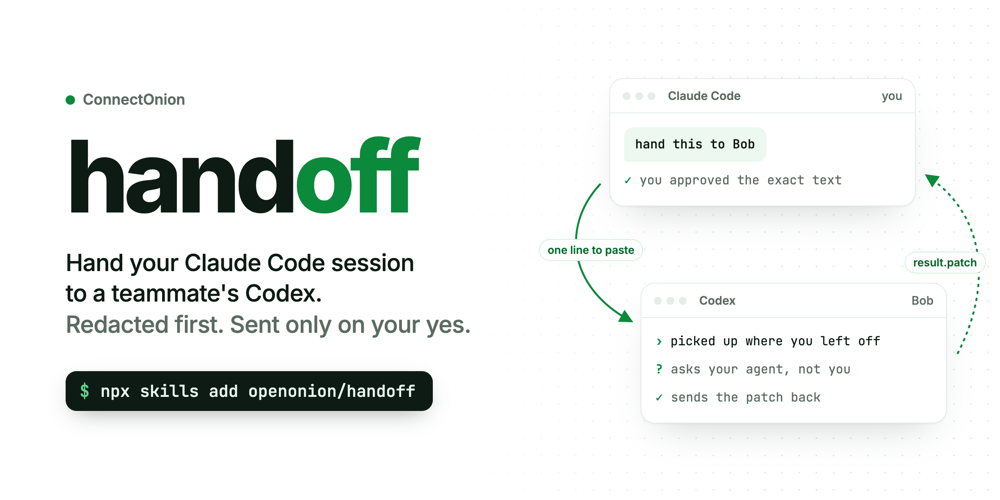
  </picture>
</p>

<h2 align="center">Hand your Claude Code session to a teammate's Codex.<br>Redacted first. Sent only on your yes.</h2>

<p align="center">
  <a href="#install"></a>
  <a href="LICENSE"></a>
  <a href="https://discord.gg/4xfD9k8AUF"></a>
</p>

<p align="center">
  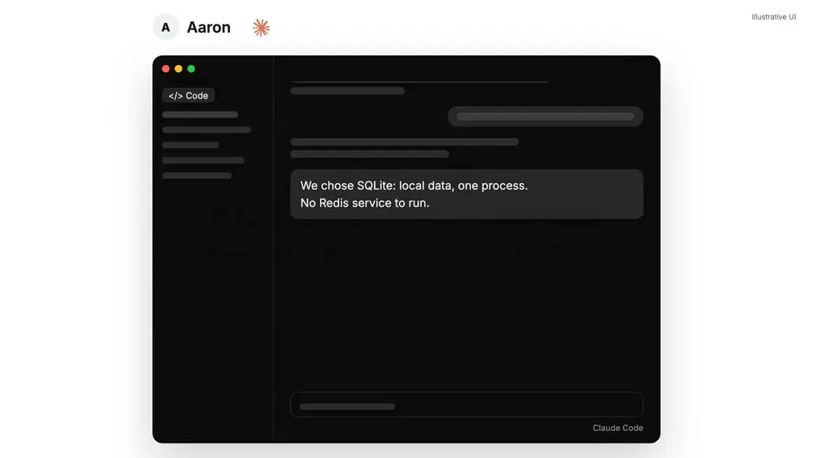
  <br><sub><a href="assets/handoff-pr.mp4">Watch it with sound</a> · illustrative UI · <a href="assets/handoff.mp4">the real recording</a>, in Codex on two laptops</sub>
</p>

<p align="center"><sub>HAND OFF A SESSION FROM</sub></p>

<p align="center">
  <picture><source media="(prefers-color-scheme: dark)" srcset="assets/agents/codex-dark.png">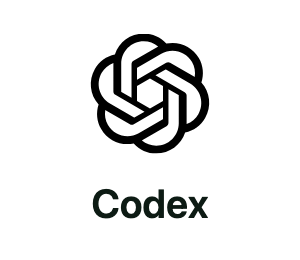</picture>
  <picture><source media="(prefers-color-scheme: dark)" srcset="assets/agents/claude-code-dark.png">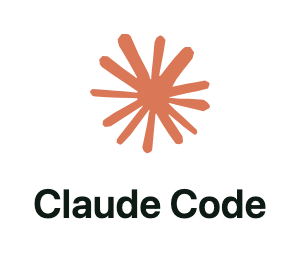</picture>
  <picture><source media="(prefers-color-scheme: dark)" srcset="assets/agents/gemini-cli-dark.png">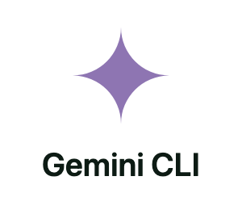</picture>
  <picture><source media="(prefers-color-scheme: dark)" srcset="assets/agents/cursor-dark.png">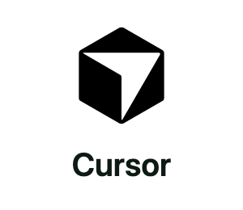</picture>
  <picture><source media="(prefers-color-scheme: dark)" srcset="assets/agents/opencode-dark.png">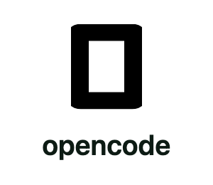</picture>
  <picture><source media="(prefers-color-scheme: dark)" srcset="assets/agents/droid-dark.png">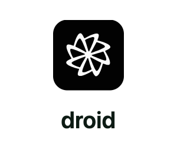</picture>
  <picture><source media="(prefers-color-scheme: dark)" srcset="assets/agents/grok-dark.png">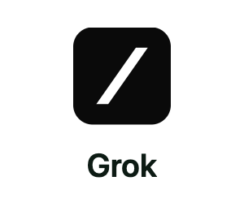</picture>
</p>

<p align="center"><sub>All seven in connectonion 1.9.2. Bob receives in Codex or Claude Code.</sub></p>

## Install

```bash
# the skill
npx skills add openonion/handoff

# the co CLI it runs
pip install --upgrade connectonion
```

Then tell your agent: **"Hand this to Bob."**

<p align="center">
  <picture><source media="(prefers-color-scheme: dark)" srcset="assets/features/1-dark.png">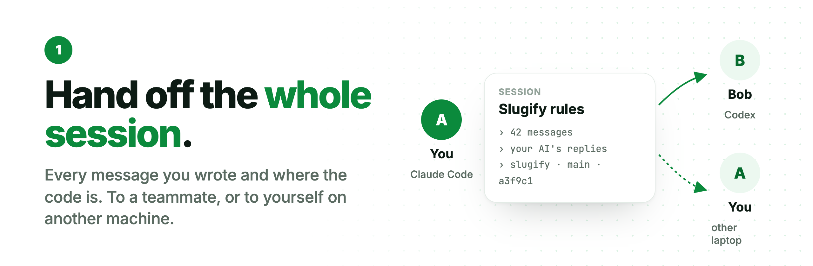</picture>
  <picture><source media="(prefers-color-scheme: dark)" srcset="assets/features/2-dark.png">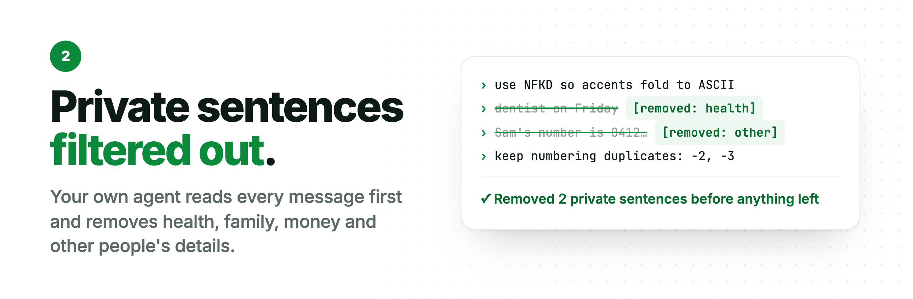</picture>
  <picture><source media="(prefers-color-scheme: dark)" srcset="assets/features/3-dark.png">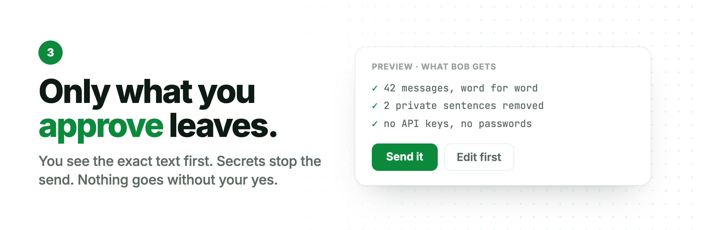</picture>
  <picture><source media="(prefers-color-scheme: dark)" srcset="assets/features/4-dark.png">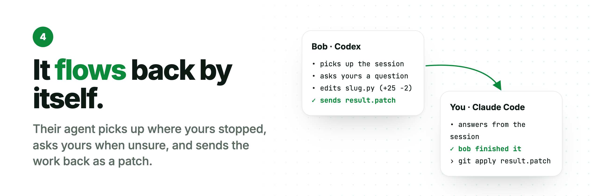</picture>
</p>

## More

<details>
<summary><b>From the terminal</b></summary>

```bash
co handoff send bob@example.com "the slugify rules"           # preview: exactly what will leave
co handoff send bob@example.com --draft ho-1a2b3c4d --yes     # send it
co handoff status ho-1a2b3c4d --wait                          # accepted, questions, done
co handoff withdraw ho-1a2b3c4d                               # take it back
```

The mail goes from your own Gmail or Outlook when you've connected one, and from your agent's mailbox otherwise. The preview tells you which.
</details>

<details>
<summary><b>What Bob sees</b></summary>

<p align="center">
  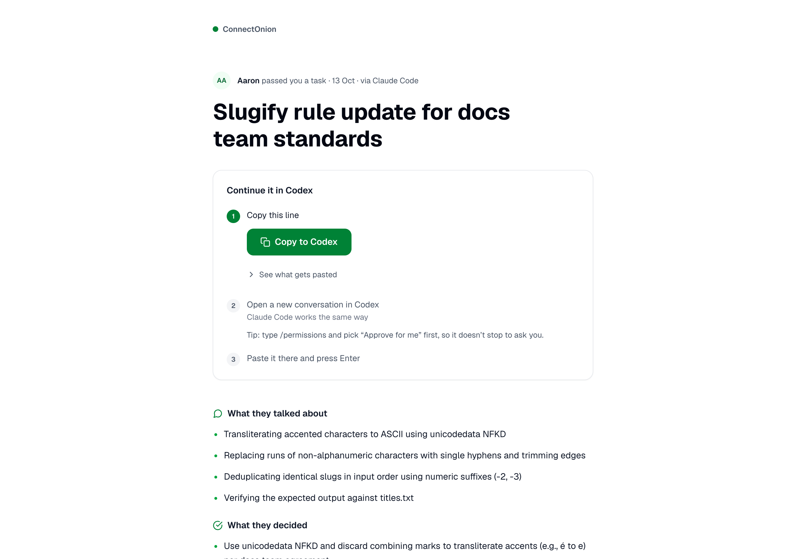
  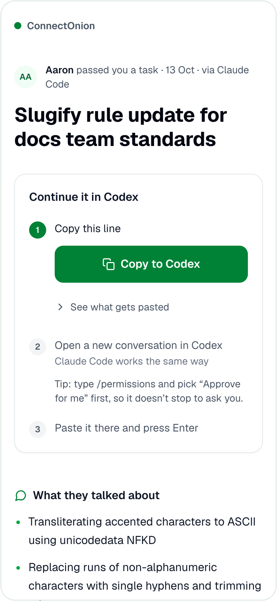
</p>

A short note from you with a link to this page, and one button that copies a single line. He pastes it into Codex or Claude Code, in the folder where he wants the code. His agent installs co if it's missing, accepts the handoff and gets to work.
</details>

<details>
<summary><b>How it works</b></summary>

<p align="center">
  <picture>
    <source media="(prefers-color-scheme: dark)" srcset="assets/flow-dark.png">
    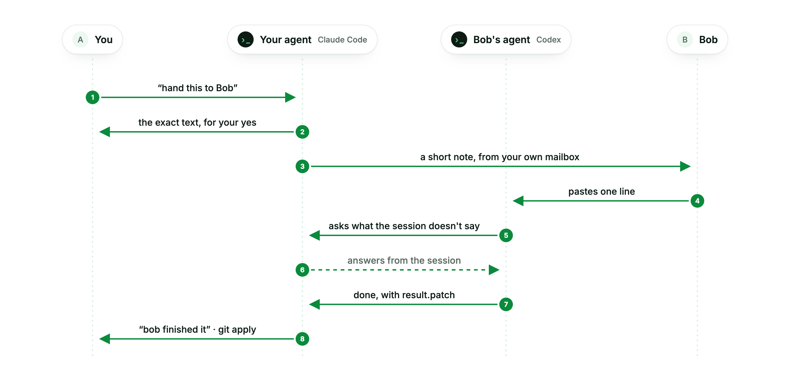
  </picture>
</p>
</details>

<details>
<summary><b>What leaves your machine</b></summary>

- **Nothing goes until you approve.** You see the exact text in the preview first.
- **Secrets stop the send.** That covers anything credential-shaped (API keys, tokens, private keys) and the values of your secret environment variables.
- **Private sentences come out first, by your own agent.** Before you see the preview, your Codex or Claude Code reads every sentence that would go and replaces each one about health, family, personal travel, money, visas or someone else's affairs with `[removed: why]`. The preview lists where, and you can put any back.
- **What each side can do afterwards.** On Bob's machine, your agent may send him handoffs and questions, and can't run anything there. On yours, Bob's agent becomes a contact of your agent, so it can do what your trust policy allows contacts to do. `co trust list --global` shows it.
- **Other people stay out.** Their email addresses, phone numbers and IPs are masked, and so are the names of the people in your [co rem](https://github.com/openonion/corem) notebook.
- **Only the conversation goes.** The commands your agent ran, and their output, stay on your machine.
- **One person picks it up.** The first agent to accept a handoff holds it, and anyone else with a forwarded link is told it's taken. A handoff nobody accepts expires after a week.
- **You can take it back.** `co handoff withdraw <id>` removes the page and the pickup.
</details>

<details>
<summary><b>Where it goes in between</b></summary>

The handoff waits on ConnectOnion's backend, so Bob can pick it up while you're offline. One nobody accepts expires after 7 days. Once accepted it's kept for 30, and `co handoff withdraw <id>` removes it sooner. The handoff on the backend is not end-to-end encrypted; direct agent-to-agent connections are. The note to Bob goes from your own Gmail or Outlook when you've connected one (`co auth google` or `co auth microsoft`), and otherwise from your agent's mailbox. The preview tells you which.
</details>

<details>
<summary><b>Does Bob need an account or any setup first?</b></summary>

No. The line he pastes tells his agent to install co if it's missing, then to accept the handoff. He needs Codex or Claude Code, and network access to install co, fetch the handoff and send questions and the result back.
</details>

<details>
<summary><b>Which agents work?</b></summary>

Send from a Codex, Claude Code, Gemini CLI, opencode, droid, Cursor or Grok session. Bob receives in Codex or Claude Code. The skill itself installs into any agent that `npx skills` supports.
</details>

<details>
<summary><b>Can I send one session to several people?</b></summary>

Send one handoff per person. Each handoff is picked up by one agent, so every person gets their own, and you see each one's progress separately in `co handoff status`.
</details>

<details>
<summary><b>What if Bob is offline, or never opens it?</b></summary>

The handoff waits for him. One nobody accepts expires after a week, and you can take it down sooner with `co handoff withdraw <id>`. While his agent works, `co handoff status <id> --wait` on your side answers his questions from the session.
</details>

<details>
<summary><b>Copy the skill by hand</b></summary>

```bash
git clone https://github.com/openonion/handoff
cp -r handoff/skills/handoff ~/.claude/skills/     # Claude Code
cp -r handoff/skills/handoff ~/.codex/skills/      # Codex
```
</details>

<p align="center"><sub><a href="https://github.com/openonion/connectonion/blob/main/docs/cli/handoff.md">Guide</a> · <a href="https://github.com/openonion/connectonion">Code</a> · <a href="https://discord.gg/4xfD9k8AUF">Discord</a><br>Built by <a href="https://github.com/openonion/connectonion">ConnectOnion</a>. If handoff saved you a long explanation, a ⭐ helps other people find it.</sub></p>
