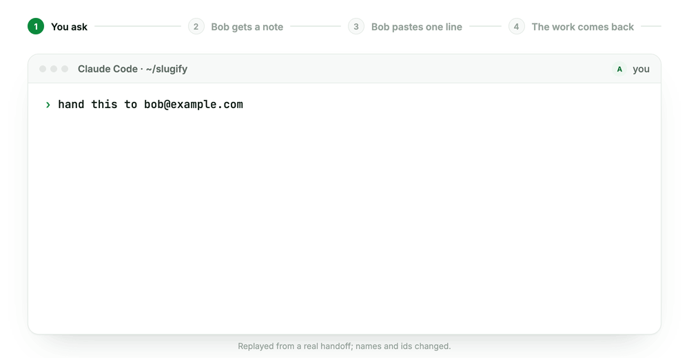
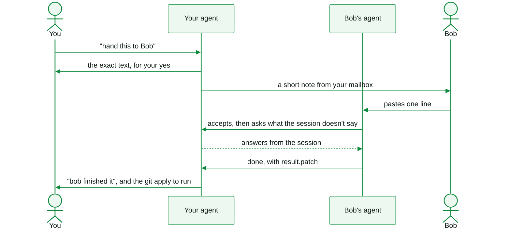

<p align="center">
  <picture>
    <source media="(prefers-color-scheme: dark)" srcset="assets/banner-dark.png">
    
  </picture>
</p>

<p align="center">
  <a href="#install"></a>
  
  
  <a href="LICENSE"></a>
  <a href="https://discord.gg/4xfD9k8AUF"></a>
</p>

You spent the afternoon getting somewhere with your coding agent. Now someone else should carry it on, and the usual handover is a Slack essay that leaves out half of what you and the AI figured out.

**handoff sends them the session itself.** That means every message you wrote, word for word, your AI's replies, and where the code is. They paste one line into Codex or Claude Code, and their agent picks up exactly where yours stopped. Anything the session doesn't answer, their agent asks yours. When the work is done, it comes back to you as a patch.

<p align="center">
  <picture>
    <source media="(prefers-color-scheme: dark)" srcset="assets/demo-dark.gif">
    
  </picture>
</p>

## Install

```bash
# The skill: Claude Code, Codex, Cursor and more
npx skills add openonion/handoff

# The co CLI it runs (co handoff ships in the 1.9.2 preview)
pip install --upgrade --pre connectonion
```

<details>
<summary>Prefer to copy the skill by hand?</summary>

```bash
git clone https://github.com/openonion/handoff
cp -r handoff/skills/handoff ~/.claude/skills/     # Claude Code
cp -r handoff/skills/handoff ~/.codex/skills/      # Codex
```
</details>

## Use it

Say it the way you would to a colleague:

> **"Hand this to Bob."**
>
> **"Pass the login task to priya@example.com."**
>
> **"交给 Bob。"**

Your agent then:
1. drafts the handoff;
2. shows you the exact text that would leave your machine;
3. sends it only after you say yes.

The mail goes from your own Gmail or Outlook, so it arrives from someone they know.

Prefer the terminal? It's the same three steps:

```bash
co handoff send bob@example.com "the slugify rules"           # preview: exactly what will leave
co handoff send bob@example.com --draft ho-1a2b3c4d --yes     # send it
co handoff status ho-1a2b3c4d --wait                          # accepted, questions, done
```

## What Bob sees

<p align="center">
  
  
</p>

- **A short note from you,** in your language, with a link to this page.
- **One button.** It copies a single line. He pastes it into a new Codex or Claude Code conversation in the folder where he wants the code.
- **His agent does the rest:**
  - installs co if it's missing;
  - accepts the handoff;
  - reads what you discussed, decided and left open;
  - gets to work.

In our own test on a small task, with Codex set to "Approve for me", the person receiving it did one thing: trust the folder. From the paste, the patch was back in under four minutes.

## How it works



## You decide what leaves

- **Nothing goes until you approve.** You see the exact text in the preview first.
- **Secrets stop the send.** That covers anything credential-shaped (API keys, tokens, private keys) and the values of your secret environment variables.
- **Other people stay out.** Their email addresses, phone numbers and IPs are masked, and so are the names of the people in your [co rem](https://github.com/openonion/corem) notebook.
- **Only the conversation goes.** The commands your agent ran, and their output, stay on your machine.
- **One person picks it up.** The first agent to accept a handoff holds it, and anyone else with a forwarded link is told it's taken. A handoff nobody accepts expires after a week.
- **You can take it back.** `co handoff withdraw <id>` removes the page and the pickup.

## Questions

<details>
<summary><b>Does Bob need an account or any setup first?</b></summary>

No. The line he pastes tells his agent to install co if it's missing, then to accept the handoff. He needs Codex or Claude Code, and network access for that one install.
</details>

<details>
<summary><b>Which agents work?</b></summary>

You can send from a Claude Code or Codex session; handoff reads either one. Bob can receive in Codex or Claude Code. The skill itself installs into any agent that `npx skills` supports.
</details>

<details>
<summary><b>Can I send one session to several people?</b></summary>

Send one handoff per person. Each handoff is picked up by one agent, so every person gets their own, and you see each one's progress separately in `co handoff status`.
</details>

<details>
<summary><b>What if Bob is offline, or never opens it?</b></summary>

The handoff waits for him. One nobody accepts expires after a week, and you can take it down sooner with `co handoff withdraw <id>`. While his agent works, `co handoff status <id> --wait` on your side answers his questions from the session.
</details>

<details>
<summary><b>Where does the handoff wait?</b></summary>

On the OpenOnion backend, until Bob's agent picks it up. It holds what you approved: the brief, the conversation, and any code you chose to send. It doesn't hold your files or the output of your agent's commands.
</details>

## Learn more

- Guide: [docs/cli/handoff.md](https://github.com/openonion/connectonion/blob/main/docs/cli/handoff.md)
- Code: [openonion/connectonion](https://github.com/openonion/connectonion) (handoff lives in `connectonion/handoff/`)
- Community: [Discord](https://discord.gg/4xfD9k8AUF)

<p align="center"><sub>Built by <a href="https://github.com/openonion/connectonion">ConnectOnion</a>. If handoff saved you a long explanation, a ⭐ helps other people find it.</sub></p>
